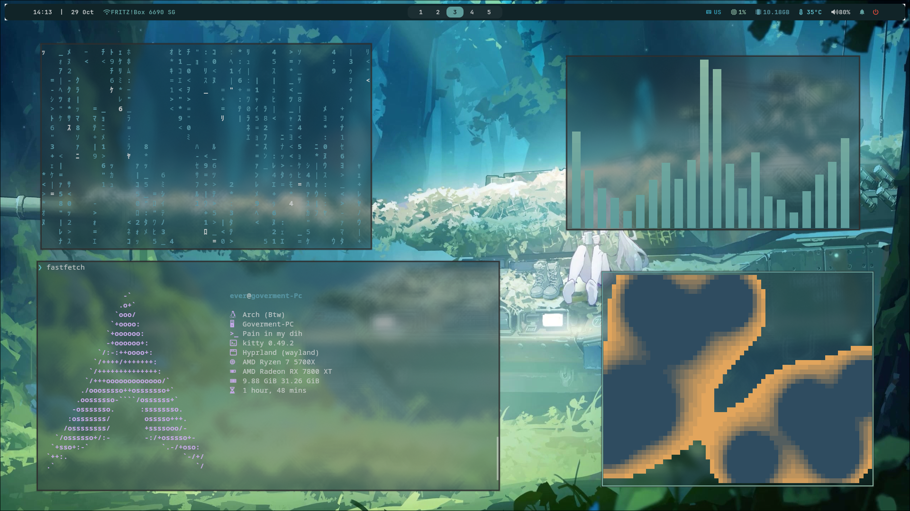
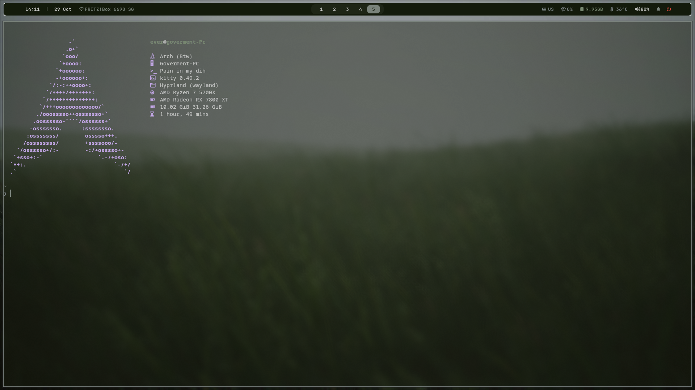
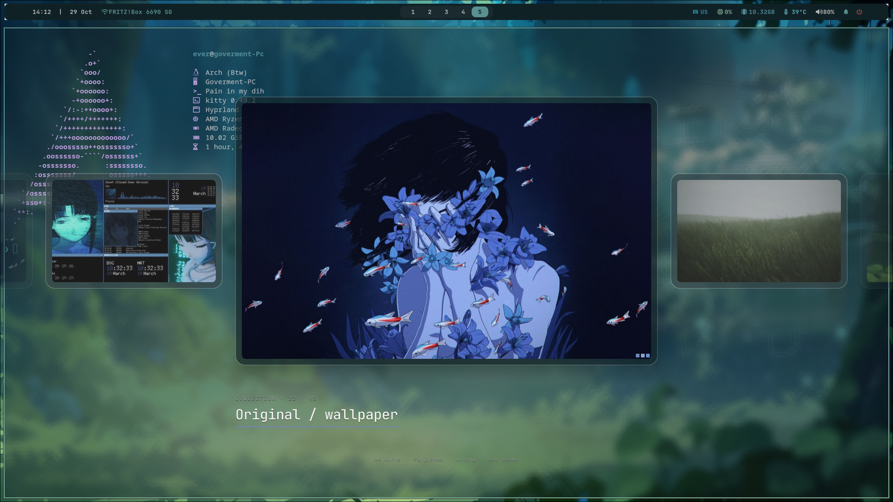

# Hyprland rice

A wallpaper-driven Hyprland desktop with an infinite floating canvas, a visual wallpaper gallery, and coordinated colors across the shell.

Built on [Teiguuu's dotfiles](https://github.com/Teiguuu/dotfiles), with a gallery adapted from [AidanMercer's world80](https://github.com/AidanMercer/world80) and canvas behavior inspired by [sarodscommits](https://github.com/sarodscommits/hyprland-infinitie-desktop-v2). Full acknowledgments are in [CREDITS.md](CREDITS.md).

## Screenshots

### Infinite desktop



### Normal desktop



### Wallpaper gallery



## Features

- Toggle an infinite canvas per workspace; pan, navigate, resize, and zoom down to 10%.
- Restore the original tiled and floating window states when leaving canvas mode.
- Browse wallpaper collections and variants in the Vernissage gallery.
- Play muted video wallpapers, with playback paused behind fullscreen windows.
- Generate and save a color palette for each wallpaper; apply it to borders, Waybar, Wofi, notifications, lock/logout screens, Cava, Kitty, and Alacritty.
- Search the current shortcuts with **Super + /**
- Capture a screen region to a file and clipboard.

## Compatibility and installation

Developed on **CachyOS / Arch Linux with Hyprland 0.57.0**, using Hyprland's Lua configuration API. Other distributions and Hyprland versions have not been validated.

From the repository directory, run these commands as your regular user inside Hyprland after installing the dependencies. The shell script installs Python 3 with your system package manager if it is missing. `--check` only reports prerequisites:

```sh
./install.sh --check
./install.sh
hyprctl reload
~/.config/hypr/scripts/start-rice.sh
```

The installer checks prerequisites, copies configuration, and backs up replaced directories. See [INSTALL.md](INSTALL.md) or the [NixOS guide](docs/NIXOS.md). Package installation and the optional wallpaper chooser are still manual; a fresh-machine installation has not been verified.

The runtime uses Kitty, Waybar, Wofi, Quickshell, Qt Multimedia, awww, pywal16, SwayNotificationCenter, Hyprlock, and wlogout. See [INSTALL.md](INSTALL.md) for the current dependency notes.

## Main shortcuts

| Shortcut | Action |
| --- | --- |
| Tap Super | Launcher |
| Super+Q | Kitty |
| Super+E | Thunar |
| Super+C | Close window |
| Super+Shift+F | Fullscreen |
| Super+Shift+3 | Toggle infinite desktop on this workspace |
| Hold Super+Alt and move mouse | Pan canvas; cursor recenters near screen edges |
| Super+Alt+wheel | Zoom canvas |
| Super+Alt+0 | Reset canvas zoom |
| Super+arrows | Focus; center a neighboring window in canvas mode |
| Super+Shift+arrows | Move window |
| Super+Ctrl+arrows | Resize canvas window |
| Super+Alt+arrows | Pan canvas |
| Super+1…0 | Switch workspace |
| Super+Ctrl+Shift+3 | Move window to workspace 3 |
| Super+Shift+T | Wallpaper gallery |
| Super+W | Random still wallpaper and matching theme |
| Super+Shift+S / Print | Screenshot region |
| Super+N | Notification center |
| Super+L | Lock |
| Super+M | Logout menu |
| Super+/ | Searchable shortcut guide |

Use the shortcut guide for the complete live list. Gallery controls: Left/Right changes collection, Up/Down changes variant, Enter applies, Escape closes.

## Wallpapers and personal settings

Put images and videos in `~/Pictures/Wallpapers`; the gallery discovers them automatically. Downloaded World80 and MoeWalls videos are not bundled in this repository. Screenshots show a personal collection, so a fresh setup will not have every pictured wallpaper.

The Fastfetch configuration in this repository detects the user's OS, host, shell, CPU, and GPU. Local monitor and keyboard overrides belong in `~/.config/hypr/local.lua`. The bar includes laptop controls that need hardware adaptation; see the installation notes.

## Repository layout

- `config/`: desktop configuration, scripts, gallery, and editor setup.
- `wallpaper/`: still images inherited from the original rice; attribution gaps are listed in [THIRD_PARTY.md](THIRD_PARTY.md).
- `screenshots/`: desktop previews.
- `licenses/`: preserved third-party license notices.
- `docs/`: plugin credits and release preparation notes.

## Credits and reuse

Please keep the upstream acknowledgments when sharing this configuration. See [CREDITS.md](CREDITS.md) for sources and [THIRD_PARTY.md](THIRD_PARTY.md) for license notices and unresolved asset provenance. No blanket license is assigned to all files in this repository.
